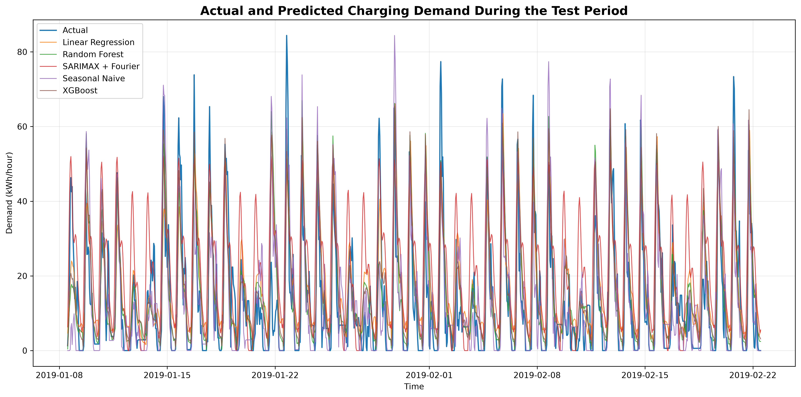
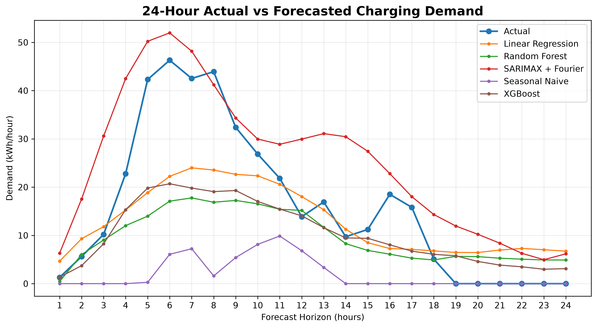
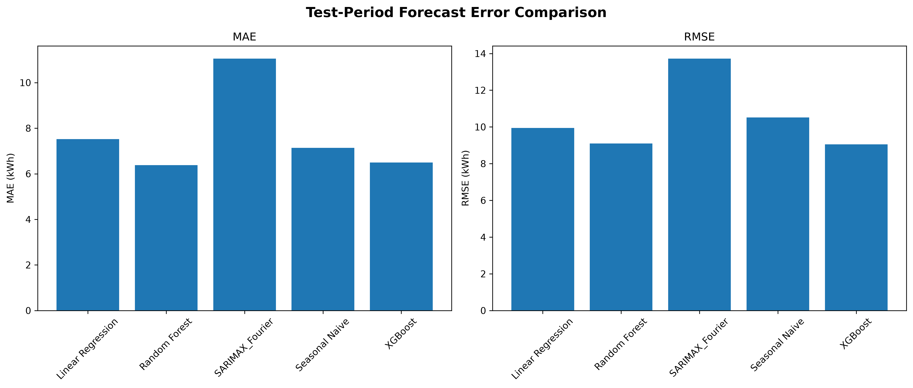
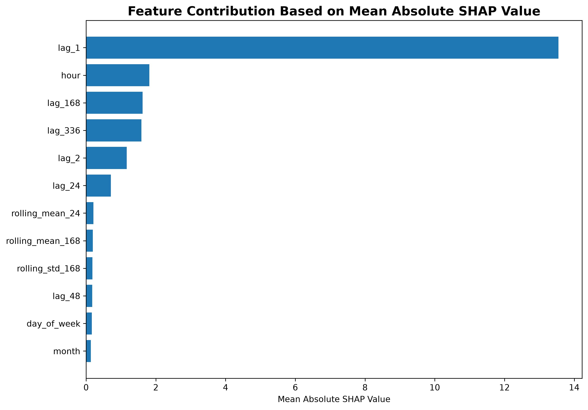
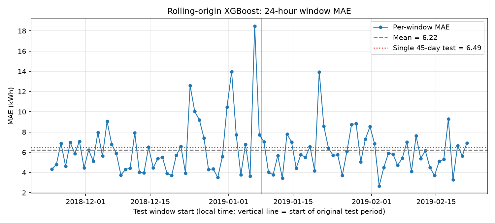
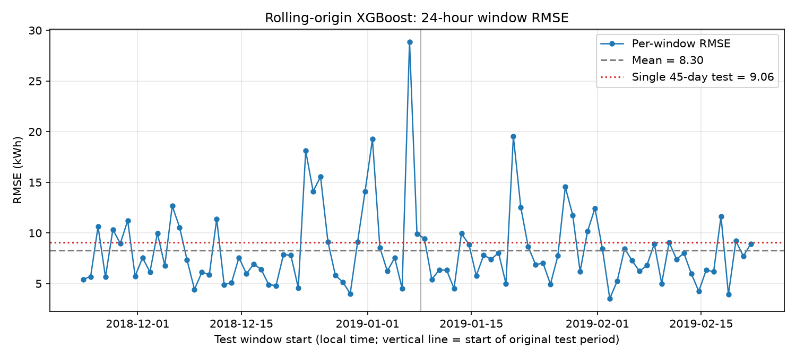
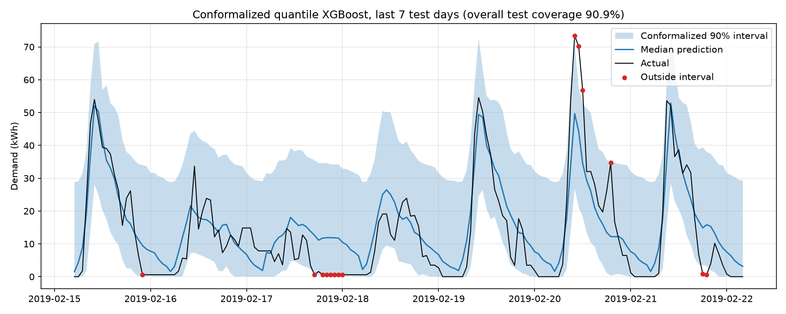
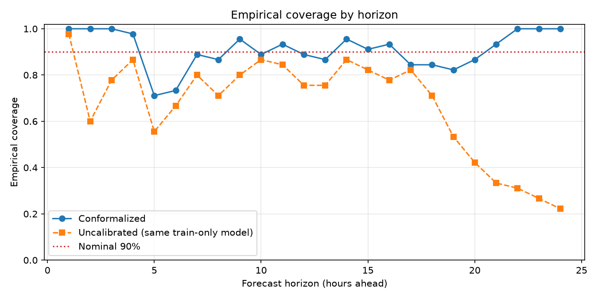

# EV Charging Demand Prediction Using Machine Learning and Time-Series Analysis

---

## TITLE PAGE

**Project Title:** EV Charging Demand Prediction Using Machine Learning and Time-Series Analysis

| | |
|---|---|
| **Student Name:** | [to be filled] |
| **PRN:** | [to be filled] |
| **Class:** | [to be filled] |
| **Division:** | [to be filled] |
| **Batch:** | [to be filled] |
| **Department:** | [to be filled] |
| **College:** | [to be filled] |
| **Academic Year:** | [to be filled] |
| **Guide:** | [to be filled] |

*Submitted in partial fulfilment of the requirements of the B.Tech (Data Science) programme.* [university / programme wording to be confirmed by the student]

---

## Contents

Abstract · Ch. 1 Introduction · Ch. 2 Literature Review · Ch. 3 Dataset and Preprocessing · Ch. 4 Methodology · Ch. 5 Results · Ch. 6 Discussion · Ch. 7 Limitations · Ch. 8 Future Work · Ch. 9 Conclusion · Figures · References · Appendices A–G · Viva Section

**Source of numbers.** Every number in this report was taken from the generated CSV files under `results/` and from `results/final_audit/` (`FINAL_AUDIT_REPORT.md`, `final_tables.md`, `table1`–`table6` CSVs). Earlier legacy files (`results/metrics/model_metrics.csv`, `results/predictions/test_predictions.csv`) are *not* used because they come from a superseded pipeline.

---

## ABSTRACT

Electric-vehicle (EV) adoption is increasing the electricity demand placed on charging infrastructure, and charging-station operators need forecasts of that demand to plan capacity and manage peak load. This project forecasts hourly EV charging demand for 24 hours ahead using the open ACN-Data dataset from a Caltech charging site. Session records (about 17,000 downloaded sessions) were converted into 7,288 consecutive hourly demand values from 25 April 2018 to 22 February 2019. Seventeen lag, rolling-statistic and calendar features were built, and the data were split chronologically into 5,101 training, 1,093 validation and 1,094 test rows. XGBoost, Random Forest, Linear Regression, a Seasonal Naive baseline and a SARIMAX model with Fourier seasonality were compared using recursive 24-hour forecasts over 45 test days (1,080 hours). XGBoost obtained MAE 6.49 kWh, RMSE 9.06 kWh and R² 0.682; Random Forest obtained 6.38, 9.10 and 0.679, and a Diebold–Mariano test found no significant difference between the two (p = 0.81). A rolling-origin evaluation over 91 daily windows gave a median MAE of 5.70 kWh and a median RMSE of 7.42 kWh, with large day-to-day variation. Quantile XGBoost produced 5%–95% prediction intervals with a nominal 90% coverage, but the measured empirical coverage was only 71.2%. After conformal calibration using validation data only, the empirical coverage on the test period was 90.9% with an average width of 34.45 kWh (versus 29.46 kWh), although coverage for peak-demand hours remained lower (72.2%). The results are specific to one site and about ten months of data and should not be generalised beyond them.

**Keywords:** EV charging, demand forecasting, XGBoost, SARIMAX, rolling-origin evaluation, quantile regression, conformal prediction, SHAP.

---

# CHAPTER 1 — INTRODUCTION

## 1.1 Background

The number of electric vehicles in use continues to grow, and the International Energy Agency tracks this growth, together with its effects on electricity grids, in its annual *Global EV Outlook* [2]. As more vehicles charge at workplaces, campuses and public stations, charging becomes a significant and time-varying electrical load. The load depends on when drivers arrive, how long they stay and how much energy they need, so it follows daily and weekly routines but also varies from day to day. Reviews of the field note that EV load modelling depends on the availability of open charging data and on a variety of statistical and machine-learning models [3]. The ACN-Data project from Caltech released a large open dataset of charging sessions that makes such studies reproducible [1].

## 1.2 Problem Statement

The problem addressed here is: *given the history of hourly charging demand at a charging site up to a certain hour, predict the demand for each of the next 24 hours, and quantify how uncertain these predictions are.* Charging demand is difficult to predict because it is made of a small number of discrete charging sessions, so it is bursty. It contains many hours with exactly zero demand and a few very large peaks, and its patterns change on holidays and during the academic calendar. A single point forecast also hides the risk that the true value will be much higher or lower, so the reliability of prediction intervals matters as well as the accuracy of the central forecast.

## 1.3 Motivation

Accurate forecasts of EV charging demand are useful for:

- **Charging-station operators**, who can schedule staff, maintenance and charging policies around expected usage.
- **Energy management**, where the expected load in each hour can be matched to supply and tariffs.
- **Infrastructure planning**, since long-run demand patterns indicate where capacity may be insufficient.
- **Peak-load management**, because high-demand hours drive capacity requirements and can be managed only if they are anticipated.
- **Resource allocation**, for example sharing limited power among simultaneously charging vehicles.

Prediction intervals add decision value because they show how much margin should be allowed around a forecast.

## 1.4 Objectives

The objectives, each implemented in the project, are:

1. To build an hourly charging-demand time series from ACN-Data session records for one Caltech site.
2. To engineer lag, rolling-statistic and calendar features that use only past information, and to verify that no data leakage occurs.
3. To forecast demand 24 hours ahead with a recursive strategy, comparing XGBoost, Random Forest, Linear Regression, a Seasonal Naive baseline and a SARIMAX + Fourier model on a chronological test period.
4. To test how stable the XGBoost results are across time with a rolling-origin evaluation of 91 daily windows.
5. To construct 90% prediction intervals with quantile XGBoost and to measure whether their empirical coverage matches the nominal level.
6. To calibrate those intervals with conformal calibration that uses validation data only, and to measure the resulting coverage and width on the test period, including by forecast horizon and for peak versus non-peak hours.
7. To explain which features drive the XGBoost predictions with SHAP.

## 1.5 Scope

**Covered:** one charging site (Caltech) in the ACN-Data dataset; hourly aggregation of charging energy; 24-hour-ahead recursive forecasting; point-forecast comparison; rolling-origin robustness; quantile and conformal prediction intervals; peak versus non-peak analysis; SHAP explanation.

**Not covered:** weather, traffic or event data; multiple sites or cities; vehicle-level or session-level prediction (only hourly total demand); deep-learning models; online model updating; grid-optimisation or pricing decisions; a dashboard evaluation (the project includes a read-only dashboard but it is not part of the scientific evaluation).

## 1.6 Contributions

1. A leakage-controlled pipeline for hourly EV charging demand forecasting with recursive 24-hour forecasts.
2. An XGBoost forecasting model (200 trees, depth 4) evaluated against Random Forest, Linear Regression, Seasonal Naive and SARIMAX + Fourier, with a Diebold–Mariano test of the differences.
3. A rolling-origin evaluation of 91 expanding-window daily forecasts of the XGBoost configuration.
4. Quantile XGBoost prediction intervals, with a measured under-coverage (71.2% against a nominal 90%).
5. Conformal calibration with validation-only calibration, which raised empirical coverage on the test period to 90.9% at the cost of wider intervals.
6. An analysis of interval coverage by forecast horizon and for peak versus non-peak hours.
7. SHAP explainability of the XGBoost features.

---

# CHAPTER 2 — LITERATURE REVIEW

*Note on references.* References marked **[P]** were already present in the project (the ACN-Data citation in the dashboard's About page). All other references were added during preparation of this report through external research. Their bibliographic details (authors, venue, year, volume and pages or DOI) were looked up on the web before inclusion; this review describes them only at the level of their titles and abstracts, and the reader should consult the originals before relying on more specific statements.

## 2.1 EV charging demand forecasting

Amara-Ouali et al. [3] reviewed open EV load data and the models used with them, and highlighted the role of open datasets in making charging-load studies comparable. The ACN-Data dataset [1] is one such open dataset; its authors describe the data from the Adaptive Charging Network and illustrate applications of it. Almaghrebi et al. [4] compared supervised machine-learning regression methods for predicting charging demand at public stations, using seven years of charging events from public stations in Nebraska, and reported that XGBoost performed slightly better than the other methods they compared. Amara-Ouali et al. [5] benchmarked models for day-ahead load and occupancy forecasting on several open charging-session datasets, with an adaptive aggregation strategy for different spatial levels. These studies motivate our use of tree-based models and of day-ahead forecasts, but their datasets, targets and metrics differ from ours, so no numerical comparison is made.

## 2.2 Time-series forecasting

Classical forecasting with ARIMA-type models is described by Box et al. [6]. Hyndman and Athanasopoulos [7] describe regression with ARIMA errors and dynamic harmonic regression, in which Fourier terms represent seasonal patterns that are too long for a standard seasonal ARIMA specification; the SARIMAX + Fourier model in this project follows that idea. Multi-step-ahead forecasting can be done with a recursive strategy (feeding predictions back as inputs) or a direct strategy, and Ben Taieb et al. [10] review and compare these strategies; we use the recursive strategy. Evaluation of time-series predictors needs care: Bergmeir and Benítez [8] studied the use of cross-validation for time-series predictor evaluation, and Bergmeir et al. [9] showed that standard K-fold cross-validation can be valid for purely autoregressive models with uncorrelated errors, which is a restricted setting that does not describe our calendar-feature, non-stationary, recursive setup. For these reasons, and because we want to mimic real forecasting where only the past is known, we use chronological splits and rolling-origin evaluation.

## 2.3 Machine-learning forecasting: Random Forest and XGBoost

Random Forest [11] averages many decorrelated regression trees. XGBoost [12] is a scalable implementation of gradient-boosted trees; in time-series forecasting, tree models are applied to tabular features such as lagged values and calendar variables. SHAP [16] assigns each feature an additive contribution to each prediction, and it is used here to describe which features the XGBoost model relies on.

## 2.4 Forecast evaluation

MAE and RMSE are standard point-forecast errors. Hyndman and Koehler [13] discuss measures of forecast accuracy and propose the mean absolute scaled error (MASE), which is also stored in the project's result files. To compare the accuracy of two forecasts, the Diebold–Mariano test [14] tests the null hypothesis of no difference in predictive accuracy while allowing the forecast errors to be serially correlated; the project uses a heteroskedasticity- and autocorrelation-consistent (HAC) variance estimate in the sense of Newey and West [15].

## 2.5 Probabilistic forecasting and conformal prediction

Hong and Fan [18] review probabilistic electric load forecasting. Gneiting et al. [19] describe the evaluation of probabilistic forecasts by calibration (statistical consistency between forecasts and outcomes) and sharpness (concentration of the forecast distribution). Quantile regression [17] estimates conditional quantiles by minimising an asymmetric absolute (pinball) loss; two quantiles can be taken as the ends of a prediction interval. Conformal prediction [20] constructs prediction sets from past forecast errors, with finite-sample coverage guarantees under the assumption that the data are exchangeable. Romano et al. [21] proposed *conformalized quantile regression* (CQR), which combines quantile regression with a conformal correction; this is the method followed here. Because time-series data are generally not exchangeable, extensions have been proposed: Xu and Xie [22] developed conformal prediction intervals for dynamic time series, and Gibbs and Candès [23] developed adaptive conformal inference for settings in which the data distribution shifts over time. These extensions were *not* implemented in this project; they are relevant to its limitations and future work.

## 2.6 Research gap addressed

The reviewed EV-load studies focus mostly on point accuracy [3–5]. This project adds a reproducible, leakage-checked 24-hour forecast evaluation for a single open dataset together with an explicit measurement of how well uncalibrated and conformally calibrated prediction intervals achieve their nominal coverage, including by horizon and for peak hours. It does not claim novelty of the individual methods.

---

# CHAPTER 3 — DATASET AND PREPROCESSING

## 3.1 Data source

The data come from ACN-Data, the open dataset of the Caltech Adaptive Charging Network [1]. The project's script `download_acndata.py` requests session records from the ACN-Data web API (`https://ev.caltech.edu/api/v1/`, which requires a personal API token) and stores them in `data/raw/acndata_caltech.csv`. The file used contains one site (`siteID` 2, the Caltech site) with 54 charging stations.

## 3.2 Dataset characteristics

| Item | Value (computed from the project files) |
|---|---|
| Raw charging sessions in the file | 17,000 |
| Connection times | 2018-04-25 11:08 UTC to 2019-02-23 01:24 UTC |
| Sessions removed | 28 (8 without a `doneChargingTime`; 20 whose charging end time was not after connection time; none with non-positive energy) |
| Usable sessions | 16,972 |
| Mean energy per session | 9.17 kWh |
| Total energy | 155,616.2 kWh |
| Hourly observations after aggregation | 7,288 (2018-04-25 to 2019-02-22), about ten months |
| Mean / median / std / max hourly demand | 21.35 / 14.89 / 20.25 / 136.36 kWh |
| Hours with zero demand | 486 (6.7%) |
| Weekday vs weekend mean demand | 24.05 kWh vs 14.53 kWh |

## 3.3 Charging-demand variable and hourly aggregation

The target variable is `demand_kWh`, the energy delivered by the site in each clock hour. It is *reconstructed* from session records, not measured by a meter. For each usable session, the delivered energy (`kWhDelivered`) is divided by the time between connection and `doneChargingTime` to give an average charging power, and this power is assumed to be constant during the session. The energy that falls in each hour is power multiplied by the overlap of the session with that hour, and the contributions of all sessions are summed per hour (`prepare_hourly_demand.py`). The results are consistent: the sum of the hourly demand equals the total delivered energy (155,616.2 kWh). Hourly aggregation was chosen because it gives a regular time series with enough observations for 24-hour forecasting and matches the time scale of operational planning.

## 3.4 Time-zone conversion

Session timestamps are stored in UTC and converted to the Caltech local time zone (America/Los_Angeles) before aggregation, so hours correspond to local clock hours. In `prepare_model_data.py` the series is re-expressed on a regular UTC hourly timeline, and the calendar features (hour, day of week, and so on) are computed from the local time. This keeps daily patterns aligned with the local clock, and the regular UTC timeline contains no duplicated or missing hours (0 time gaps were found).

## 3.5 Missing-hour handling

The hourly series was built on a continuous time index and hours without any charging were set to 0 kWh. After reindexing to the regular UTC timeline, the model dataset has 7,288 rows with 0 time gaps and 0 missing target values, so no additional gap filling was needed. The model-data script treats any missing hour as zero demand, which is the same assumption already used when the hourly series was built.

## 3.6 Feature engineering

Seventeen features are used (`prepare_model_data.py`; the same definitions are re-implemented in `train_models.py` for the recursive forecasts). No other features are used.

| Group | Features | Definition |
|---|---|---|
| Lags | `lag_1`, `lag_2`, `lag_24`, `lag_48`, `lag_168`, `lag_336` | Demand 1, 2, 24, 48, 168 (one week) and 336 (two weeks) hours earlier |
| Rolling statistics | `rolling_mean_24`, `rolling_std_24`, `rolling_mean_168`, `rolling_std_168` | Mean and standard deviation over the previous 24 and 168 hours, computed after shifting the series by one hour so that the current hour is never included |
| Calendar (local time) | `hour`, `day_of_week`, `day_of_month`, `month`, `week_of_year` | Calendar position of the target hour |
| Indicators | `is_weekend`, `is_business_hour` | 1 if Saturday/Sunday; 1 if the local hour is between 08:00 and 17:59 |

**Why lag and rolling features are useful.** Demand in the next hour is strongly related to the demand in the previous hours (`lag_1`, `lag_2`), because vehicles that are charging now are still charging soon. Demand repeats with a daily and weekly rhythm, which `lag_24`, `lag_48`, `lag_168` and `lag_336` capture directly. Rolling means summarise the recent level of demand, and rolling standard deviations summarise recent variability. Calendar features tell the model the time of day and the day of the week, which determine when vehicles arrive. The first 336 rows have no complete lag history and are not used for training; all of them lie in the training period.

---

# CHAPTER 4 — METHODOLOGY

## 4.1 Data preprocessing

Raw sessions are cleaned and aggregated to hourly energy as described in Chapter 3. The resulting hourly series (`data/processed/hourly_demand.csv`) is re-indexed on a regular UTC hourly timeline and the features are added (`data/processed/model_data.csv`). No scaling or normalisation is applied, because the models are tree-based or linear with raw-scale features, and the target is predicted in kWh.

## 4.2 Feature engineering

See Section 3.6. The key leakage-control rule is that every feature for hour *t* is calculated only from demand values at hours *t*−1 or earlier. For recursive forecasting, the same features are recomputed inside the forecasting loop from the available history (`make_features` in `train_models.py`). In the audit, features rebuilt from the history alone matched the stored feature columns for 300 randomly chosen rows (maximum absolute difference 3×10⁻¹³).

## 4.3 Chronological train/validation/test split

The 7,288 hourly rows are split in time order, not randomly:

| Set | Rows | Period (UTC) | Use |
|---|--:|---|---|
| Training | 5,101 | 2018-04-25 11:00 to 2018-11-23 23:00 | Fit candidate models |
| Validation | 1,093 | 2018-11-24 00:00 to 2019-01-08 12:00 | Choose hyper-parameters; calibrate prediction intervals |
| Test | 1,094 | 2019-01-08 13:00 to 2019-02-23 02:00 | Final evaluation only |

The test period is divided into 45 non-overlapping windows of 24 hours, giving 1,080 evaluated hours (14 test hours that do not fill a complete window are not evaluated). The validation period similarly provides 45 windows (1,080 hours). After model selection on the validation windows, the selected models are refitted on training plus validation data and then evaluated once on the test windows.

## 4.4 Forecasting setup

At the start of each 24-hour window, the model knows all demand before the window and forecasts the 24 hours of the window. Forecast horizon *h* = 1,…,24 is the number of hours ahead. All windows in the test period start at the same clock time (13:00 UTC, which is 05:00 local time), so the forecast horizon and the time of day are linked: for example *h* = 5 corresponds to 09:00 local time.

## 4.5 Recursive forecasting

Because the features of hour *t+1* include demand at hour *t*, which is not yet observed when forecasting several hours ahead, the project uses *recursive* (iterated) forecasting:

```
history known up to the forecast origin
   ↓
predict hour 1 from features built from the history
   ↓
the prediction (set to ≥ 0) is appended to the history
   ↓
features for hour 2 are rebuilt from the extended history → predict hour 2
   ↓
… repeat until hour 24
```

Within a window, only the model's own predictions are appended; actual demand values from the window being forecast are never used. Negative predictions are set to zero. The recursive strategy is one of the multi-step strategies reviewed in [10]; its disadvantage is that errors in early predictions can propagate to later hours.

## 4.6 Machine-learning and baseline models

- **Linear Regression:** ordinary least squares on the 17 features (default scikit-learn settings).
- **Random Forest:** an average of many decision trees [11]. Three candidates were compared on the validation windows: (200 trees, max depth 15, min leaf 2), (300, 20, 2) and (300, no depth limit, 2). The second candidate (300 trees, depth 20) had the lowest validation RMSE (11.4238; the third was 11.4239, i.e. essentially tied) and was selected.
- **XGBoost:** gradient-boosted regression trees [12]; configuration in Section 4.8.
- **Seasonal Naive:** the forecast for each of the 24 hours is the actual demand at the same clock hour exactly one week earlier (the 24 hours 168 to 145 hours before the forecast origin). It requires no model fitting and serves as a baseline.

## 4.7 SARIMAX + Fourier

SARIMAX in this project is a regression with ARMA errors (`train_sarima.py`): ARMA(1, 0, 1) errors (`order = (1, 0, 1)`), a constant trend, and no seasonal ARIMA component (`seasonal_order = (0, 0, 0, 0)`). Daily (period 24 h) and weekly (period 168 h) seasonality is represented by Fourier terms as external regressors, with 3 harmonics for each period (K = 3 and K = 3). Stationarity and invertibility are not enforced, and the optimiser is limited to 100 iterations. For every forecast window, the model is refitted on all earlier history, forecasts 24 steps ahead using the future values of the Fourier terms, and negative forecasts are set to zero. The same 45 test windows are used as for the other models. The result applies to this specific, modest configuration.

## 4.8 XGBoost configuration

| Parameter | Value |
|---|---|
| `n_estimators` | 200 |
| `max_depth` | 4 |
| `learning_rate` | 0.05 |
| `subsample` | 0.8 |
| `colsample_bytree` | 0.8 |
| `objective` | `reg:squarederror` |
| `random_state` | 42 |

(`n_jobs = -1`, i.e. all CPU cores, is also set but does not affect the model definition.) Three XGBoost candidates were compared on the validation windows: this one (validation RMSE 10.92), (300 trees, depth 6, rate 0.05; 11.74) and (400 trees, depth 4, rate 0.03; 11.67). The first had the lowest validation RMSE and was selected; no further tuning was done.

## 4.9 Rolling-origin evaluation

To test stability over time, the selected XGBoost configuration was evaluated on 91 consecutive daily forecast windows. For each fold, the model is trained only on data before the 24-hour test window, so that the training window expands by 24 hours with each fold (4,765 training rows in fold 1 to 6,925 in fold 91). It then forecasts the next 24 hours with the same features and the same recursive logic, and MAE, RMSE and R² are computed for that window. The first test window starts at 2018-11-24 00:00 UTC and the last ends at 2019-02-22 23:00 UTC; folds 1–46 lie in the former validation period and folds 47–91 in the former test period. The evaluation is purely chronological.

**Why random cross-validation is inappropriate here.** Randomly assigning hours to folds would place hours from the future in the training set while testing on earlier hours, and neighbouring hours are highly correlated, so the test score would be optimistic and would not reflect real forecasting, where only the past is known. Our features (lags and rolling windows) overlap heavily with neighbouring hours. Although cross-validation can be valid for purely autoregressive models with uncorrelated errors [9], that condition does not hold for this calendar-driven, non-stationary and recursively forecast problem, so we use forward-chaining evaluation [8].

## 4.10 Quantile prediction intervals

To obtain prediction intervals, XGBoost was trained with the quantile objective (`reg:quantileerror`) for three quantile levels, 0.05, 0.50 and 0.95, in one model (XGBoost version 3.4.1; all other settings as in Section 4.8). The 5th and 95th percentile predictions are the lower and upper limits of a **nominal 90% prediction interval**: if the quantile predictions were accurate, 90% of actual values would fall inside. The 50th percentile (median) is used as the point forecast and is the value fed back into the history in the recursive loop. Quantile crossings are removed by sorting (none occurred), and bounds are set to be at least 0. In this first experiment the model was trained on training plus validation data, as in the baseline final fit.

## 4.11 Conformal calibration

Conformalized quantile regression [21] was used to correct the interval. The steps were:

1. Fit the quantile model on **training data only** (4,765 rows).
2. Run recursive 24-hour forecasts over the 45 **validation** windows to obtain 1,080 forecast intervals [lower, upper].
3. For each validation hour with actual demand *y*, compute the conformity score *s* = max(lower − *y*, *y* − upper). This is negative when *y* is inside the interval and equals the distance outside it otherwise.
4. Take the empirical quantile of the 1,080 scores at level ⌈(*n*+1)(1−α)⌉/*n* with α = 0.10, giving the calibration offset **q̂ = 2.63 kWh** (2.634 kWh).
5. On the test windows, forecast with the same train-only model and widen the interval to [max(0, lower − q̂), upper + q̂].

Test data were used only to measure the result. The test set was not used for fitting or calibration. The validation coverage rose from 68.8% to 90.2% after the offset was applied (this is expected, because the offset was chosen on those scores). The conformal model is deliberately *not* refitted on training plus validation data, since the calibration is valid only for the model that was calibrated. This difference is important for comparisons (Section 6.9).

## 4.12 SHAP explainability

SHAP [16] assigns each feature a contribution to each prediction, and the mean absolute SHAP value over many predictions measures how strongly the model uses each feature. The script `run_shap_analysis.py` fits an XGBoost model with the same configuration (and a Random Forest) on training plus validation data and computes SHAP values on the 1,094 test rows. These test-row features use actual past demand (a one-step setting), not the recursively predicted lags used for the 24-hour forecasts, so SHAP describes feature use in that setting and not exactly the recursive pipeline.

## 4.13 Peak-demand analysis

Peak hours are defined with a percentile threshold. In the peak and interval analyses, a test hour is a *peak* hour if its actual demand is at or above the 90th percentile of the actual demand over the 1,080 evaluated test hours, which is **37.46 kWh** (108 hours). The remaining 972 hours are non-peak. (A different, whole-dataset P90 of 51.29 kWh appears in `high_demand_thresholds.csv`; it is not used for the interval analysis.) Because peak is defined from the *actual* value, peak coverage describes how often an interval contains an unusually high actual value.

## 4.14 Evaluation metrics

MAE, RMSE and R² (definitions in Appendix C) are computed on the pooled forecast hours. Empirical coverage is the fraction of actual values that lie inside the interval; interval width is upper minus lower bound, averaged. The Diebold–Mariano test uses squared-error loss, a HAC lag of 23 and 1,080 forecast hours per comparison.

---

# CHAPTER 5 — RESULTS

All results are for the evaluated test period (45 windows, 1,080 hours; 2019-01-08 13:00 UTC to 2019-02-22 12:00 UTC) unless stated otherwise.

## 5.1 Point forecasting results

**Table 5.1 — Point-forecast comparison**

| Model | MAE (kWh) | RMSE (kWh) | R² | MASE |
|---|--:|--:|--:|--:|
| XGBoost | 6.49 | 9.06 | 0.682 | 0.731 |
| Random Forest | 6.38 | 9.10 | 0.679 | 0.718 |
| Linear Regression | 7.52 | 9.94 | 0.617 | 0.847 |
| Seasonal Naive | 7.14 | 10.52 | 0.572 | 0.804 |
| SARIMAX + Fourier | 11.06 | 13.73 | 0.270 | 1.258 |

These values reproduce exactly when recomputed from the stored prediction files. Random Forest has the lowest MAE, while XGBoost has the lowest RMSE and highest R²; the RMSE difference between them is 0.04 kWh. A Diebold–Mariano test on the squared forecast errors (HAC lag 23, 1,080 hours) gives:

**Table 5.2 — Diebold–Mariano tests (squared-error loss)**

| Comparison | DM statistic | p-value | Significant at 5%? |
|---|--:|--:|---|
| Random Forest vs XGBoost | 0.240 | 0.81 | No |
| Linear Regression vs XGBoost | 4.143 | 3.4 × 10⁻⁵ | Yes |
| Seasonal Naive vs XGBoost | 3.129 | 0.0018 | Yes |
| SARIMAX + Fourier vs XGBoost | 9.418 | < 0.001 | Yes |
| Linear Regression vs Random Forest | 3.088 | 0.0020 | Yes |
| Random Forest vs Seasonal Naive | −3.282 | 0.0010 | Yes |
| Linear Regression vs Seasonal Naive | −1.107 | 0.27 | No |
| Random Forest vs SARIMAX + Fourier | −8.649 | < 0.001 | Yes |
| Linear Regression vs SARIMAX + Fourier | −7.504 | < 0.001 | Yes |
| SARIMAX + Fourier vs Seasonal Naive | 4.912 | < 0.001 | Yes |

Interpretation: the difference between XGBoost and Random Forest is **not statistically significant** (p = 0.81), so the two should be regarded as performing similarly on this test period; the data do not support a claim that either is more accurate. Both differ significantly from Seasonal Naive and from this SARIMAX + Fourier configuration. Linear Regression and Seasonal Naive are not significantly different from each other.

**Baseline reproducibility caveat.** An independent re-run of the XGBoost baseline in the audit environment (XGBoost 3.4.1) gave MAE 6.46, RMSE 9.03 and R² 0.684, slightly different from the stored 6.49, 9.06 and 0.682. The difference already appears at the first forecast hour, so it comes from model fitting and is most likely due to differences in the software versions between environments (the original versions could not be checked). The stored values are cited throughout. The rolling-origin and interval experiments were run with XGBoost 3.4.1.

## 5.2 Rolling-origin results

**Table 5.3 — Rolling-origin XGBoost, 91 daily windows (per-window statistics)**

| Metric | Mean | Std | Median | Min | Max |
|---|--:|--:|--:|--:|--:|
| MAE (kWh) | 6.22 | 2.54 | 5.70 | 2.66 | 18.48 |
| RMSE (kWh) | 8.30 | 3.96 | 7.42 | 3.52 | 28.87 |
| R² (per 24-h window) | −1.87 | 14.43 | 0.65 | −134.34 | 0.95 |

Of the 91 windows, 20 have a negative R² and 51 have an R² of at least 0.5. When all forecast hours of the folds are pooled (each window has 24 equally weighted hours), the MAE is 6.22 kWh, the RMSE is 9.19 kWh and R² is 0.672 over all 91 folds, and for the 45 folds inside the former test period the MAE is 6.01, the RMSE is 8.45 and R² is 0.728. These pooled values come from models that are refitted every day on expanding data, so they are a different experiment from the single 45-day test (6.49, 9.06, 0.682); they suggest that the average level of error is similar, not identical.

**The mean per-window R² must not be compared directly with the pooled R².** R² compares the squared error of a window with the variance of the actual demand *within that window*. On a day with very low or flat demand the variance is tiny, so even a moderate absolute error yields a very large negative R². For example, fold 33 (window starting 2018-12-26 00:00 UTC) had a mean demand of only 1.62 kWh and an MAE of 9.21 kWh, which gives R² = −134.34. Seven windows have R² below −5 (all with mean demand below 6 kWh, mostly around Christmas and New Year, and one coinciding with Martin Luther King Jr. Day). The pooled R² divides the total error by the total variance across many days, which is much larger, so it is the appropriate summary; the median per-window R² (0.65) is a more robust single-day summary than the mean.

**Difficult and easier windows.** The hardest windows by RMSE were fold 45 (28.87 kWh; mean demand 24.35 kWh; window beginning 6 January 2019 at 16:00 local time), fold 59 (19.53), fold 40 (19.26), fold 31 (18.11) and fold 33 (15.55). The easiest were folds 72 (RMSE 3.52), 88 (3.94), 37 (4.01), 84 (4.25) and 16 (4.44). Absolute errors are therefore moderately variable (the interquartile range of the MAE is 4.43 to 7.03 kWh) with a few days several times worse than the median (maximum MAE 18.48 kWh), and the window's mean demand has almost no correlation with its MAE (r = 0.09), so difficulty is not simply a matter of busy days.

## 5.3 Quantile prediction intervals (uncalibrated)

**Table 5.4 — Quantile XGBoost (5%–95%), trained on training + validation**

| Measure | Value |
|---|--:|
| Nominal coverage | 90% |
| **Empirical coverage** | **71.2%** (769 of 1,080 hours) |
| Average interval width | 29.46 kWh |
| Actual below the lower bound | 23.4% |
| Actual above the upper bound | 5.4% |
| Median-prediction MAE / RMSE | 7.20 / 10.33 kWh |

The intervals **under-covered**: they contained 71.2% of the actual values, 18.8 percentage points less than the nominal 90%. They are therefore not reliable 90% intervals. A large part of the misses are hours in which the actual demand was below the lower bound (23.4%), many of which are night hours with exactly zero demand: 201 of the 1,080 test hours had zero demand, and only 21% of them were inside the interval, because the 5th-percentile bound averaged 1.24 kWh on those hours. A day-level bootstrap suggests an approximate 95% range of 66.9%–75.6% for this coverage (a rough indication only, as neighbouring days are not independent).

## 5.4 Conformal calibration

**Table 5.5 — Prediction-interval comparison**

| Method | Nominal | Empirical coverage | Avg width (kWh) | Rows used to fit the model |
|---|--:|--:|--:|--:|
| Quantile XGBoost, uncalibrated (trained on training + validation) | 90% | 71.2% | 29.46 | 5,858 |
| Quantile XGBoost, uncalibrated (trained on training only) | 90% | 66.9% | 29.63 | 4,765 |
| **Conformalized quantile XGBoost** (trained on training only; offset from validation) | 90% | **90.9%** | **34.45** | 4,765 |

The calibration offset was **q̂ = 2.63 kWh** (1,080 validation scores). With the same training-only model, the offset raised the empirical test coverage from 66.9% to 90.9% (+24.0 percentage points) and widened the average interval by 4.82 kWh (+16.3%). Relative to the first quantile experiment (71.2%, 29.46 kWh), the change is +19.7 percentage points of coverage and +4.98 kWh (+16.9%) of width. Of the test hours, 6.2% were below the lower bound and 2.9% above the upper bound. A day-level bootstrap gives an approximate 95% range of 88.5%–93.1% for the overall coverage (a rough indication only).

These are **empirical coverage** results measured on one test period; they do not establish a theoretical or guaranteed 90% coverage. Conformal guarantees depend on the exchangeability of the calibration and test data, which hourly time series with daily cycles, trends and holidays do not strictly satisfy; also, the calibration windows (starting at 16:00 local time) and the test windows (starting at 05:00 local time) begin at different clock times.

## 5.5 Peak versus non-peak

**Table 5.6 — Coverage for peak and non-peak hours (peak = actual ≥ 37.46 kWh)**

| Method | Period | Hours | Coverage | Avg width (kWh) |
|---|---|--:|--:|--:|
| Quantile (uncalibrated) | Non-peak | 972 | 73.7% | 28.81 |
| Quantile (uncalibrated) | Peak | 108 | 49.1% | 35.35 |
| Conformalized | Non-peak | 972 | **93.0%** | 33.65 |
| Conformalized | Peak | 108 | **72.2%** | 41.67 |

After conformal calibration the coverage for non-peak hours was 93.0%, but for peak hours it was 72.2%. All misses in peak hours were above the upper bound (27.8% of the peak hours after calibration; 50.9% before). The point forecasts explain why: in the peak-analysis outputs the XGBoost error (actual minus prediction) averages +8.25 kWh in peak hours, i.e. peaks are under-predicted, and the XGBoost MAE is 12.59 kWh in peak hours against 5.82 kWh in non-peak hours. Peaks are rare (10% of test hours by construction), large and driven by how many vehicles arrive at once, and one global widening cannot make up for an error that is concentrated in peaks. In addition, because "peak" is defined from the actual outcome being high, intervals will tend to contain such outcomes less often than they contain typical outcomes.

For reference, the existing peak-detection output (predicted demand at or above 37.46 kWh used as a peak alarm) gives for XGBoost a precision of 0.650, recall 0.741 and F1 0.693; for Random Forest 0.642, 0.713 and 0.675; for SARIMAX + Fourier 0.468, 0.870 and 0.608; for Linear Regression 0.633, 0.639 and 0.636; and for Seasonal Naive 0.625, 0.648 and 0.636. These describe peak classification and are not a ranking of the models.

## 5.6 Horizon analysis

**Table 5.7 — Coverage by forecast horizon (45 observations per horizon; nominal 90%)**

| h | Uncalibrated | Conformal | | h | Uncalibrated | Conformal |
|--:|--:|--:|---|--:|--:|--:|
| 1 | 97.8% | 100.0% | | 13 | 82.2% | 86.7% |
| 2 | 95.6% | 100.0% | | 14 | 91.1% | 95.6% |
| 3 | 91.1% | 100.0% | | 15 | 86.7% | 91.1% |
| 4 | 93.3% | 97.8% | | 16 | 86.7% | 93.3% |
| 5 | 46.7% | 71.1% | | 17 | 84.4% | 84.4% |
| 6 | 62.2% | 73.3% | | 18 | 73.3% | 84.4% |
| 7 | 77.8% | 88.9% | | 19 | 57.8% | 82.2% |
| 8 | 73.3% | 86.7% | | 20 | 44.4% | 86.7% |
| 9 | 86.7% | 95.6% | | 21 | 33.3% | 93.3% |
| 10 | 86.7% | 88.9% | | 22 | 33.3% | 100.0% |
| 11 | 91.1% | 93.3% | | 23 | 26.7% | 100.0% |
| 12 | 82.2% | 88.9% | | 24 | 24.4% | 100.0% |

Coverage varies widely with the horizon. Before calibration it ranged from 24.4% (h = 24) to 97.8% (h = 1). After conformal calibration, the coverage was 100% at h = 1–3 and h = 22–24, 97.8% at h = 4, but only 71.1% and 73.3% at h = 5 and h = 6, and 82–84% at h = 17–19, so several horizons remained below 90%. Because every test window begins at 05:00 local time, h = 1 to 4 correspond to quiet early-morning hours (05:00–08:00), h = 5 and 6 to the morning arrival ramp (09:00–10:00), and h = 20 to 24 to the night hours (00:00–04:00). By local clock hour, the conformal coverage is 100% between 02:00 and 07:00 (very low demand, where the intervals are wider than needed) and about 71–73% at 09:00 and 10:00. This indicates that the variation across horizons mainly reflects the time of day (and its demand level) rather than a steady accumulation of error with the horizon. The 100% coverage at some horizons means the single global offset makes the intervals wider than necessary there, while the lower coverage at the morning ramp shows that it does not fix horizon-specific error. Each horizon estimate rests on only 45 observations (a sampling error of about ±9 percentage points at 90%). For the same reason, horizon-wise error curves from the test set are not directly comparable with the rolling-origin windows, which start at 16:00 local time.

The XGBoost RMSE by horizon on the test set ranges from 1.56 kWh (h = 1) to 15.33 kWh (h = 5), and the MAE from 1.24 to 12.39 kWh.

## 5.7 Feature importance (SHAP)

For the XGBoost model (mean absolute SHAP values over the 1,094 test rows), the most important features are `lag_1` (12.71, about 58.9% of the total), `hour` (1.90, 8.8%), `lag_336` (1.88, 8.7%), `lag_168` (1.71, 7.9%), `lag_2` (1.05, 4.9%) and `lag_24` (0.77, 3.6%). The four rolling statistics, `day_of_week`, `month`, `is_business_hour`, `lag_48`, `day_of_month`, `is_weekend` and `week_of_year` each contribute 1.4% or less. Figure 4 shows the average of the Random Forest and XGBoost importances, for which `lag_168` ranks slightly above `lag_336`.

---

# CHAPTER 6 — DISCUSSION

**6.1 XGBoost point forecasting.** XGBoost achieved an MAE of 6.49 kWh, an RMSE of 9.06 kWh and an R² of 0.682 on the evaluated test period, where the mean hourly demand over the dataset is 21.35 kWh. Its errors were lower than those of Linear Regression, Seasonal Naive and the SARIMAX + Fourier configuration, and the differences were statistically significant. SHAP shows that the most recent hour dominates the model, with the hour of day and the same hour one and two weeks earlier next; this is consistent with a system whose demand is persistent from hour to hour and repeats daily and weekly.

**6.2 Random Forest comparison.** Random Forest achieved a slightly lower MAE (6.38 kWh) and XGBoost a slightly lower RMSE (9.06 kWh against 9.10 kWh). The Diebold–Mariano test (p = 0.81) does not detect a difference, so the two models should be regarded as equivalent on this test period; the choice of XGBoost as the base model for the later experiments was a design decision, not a result of a statistical superiority.

**6.3 SARIMAX behaviour.** The SARIMAX + Fourier configuration had the largest errors (MAE 11.06 kWh, RMSE 13.73 kWh, R² 0.270) and tends to repeat a smooth daily pattern (see Figure 1). Its configuration is limited (three harmonics for each period, ARMA(1,0,1) errors, no seasonal differencing), so the result applies to this configuration and not to SARIMAX models in general. It does not use recent demand values as inputs in the way the lag-feature models do, which is one possible reason for its larger errors; this was not tested separately.

**6.4 Rolling-origin robustness.** The median daily error (MAE 5.70, RMSE 7.42 kWh) and the pooled error over the folds are close to the single-test figures, so the average level of accuracy is consistent across different periods. Day-to-day variation is large, however: the worst day had an MAE of 18.48 kWh, about three times the median. Several of the hardest windows coincide with the Christmas and New Year period or with a public holiday, when the demand pattern differs from a normal week. The single 45-day test is therefore one sample from a distribution of daily errors with a wide spread, and any single-day R² should be interpreted with caution.

**6.5 Uncertainty estimation.** A point forecast does not show how far the actual demand may deviate from it. The 90% interval of the quantile model was intended to supply that range, but its measured empirical coverage (71.2%) showed that it was too narrow, so measuring coverage was necessary.

**6.6 Quantile under-coverage.** Several factors are consistent with the observed under-coverage. The intervals come from a single recursive forecast path (the median is fed back), so they do not include the extra error that builds up over 24 steps. The lower bound sat slightly above zero on many no-demand night hours, where the actual demand was exactly zero (21% of those hours were inside the interval), and the model under-predicted peaks (all peak misses were above the upper bound). The first factor is a plausible explanation and was not tested separately.

**6.7 Conformal calibration improvement.** Calibration on the validation windows widened the intervals by q̂ = 2.63 kWh on each side. On the test period, the empirical coverage rose to 90.9% and the interval width by about 17% (29.46 to 34.45 kWh compared with the first quantile run; 29.63 to 34.45 kWh for the same training-only model). This shows that a small data-driven correction brought the empirical coverage close to the nominal level for this test period. It does not prove that the intervals would be calibrated on other sites or seasons.

**6.8 Peak-demand uncertainty and horizon effects.** Peak-hour coverage remained at 72.2% after calibration, and the coverage was uneven across horizons (71.1% to 100%). Both observations show that a single global correction improves the average coverage but not the coverage in specific conditions: during peaks, and at certain times of the day (in particular the morning ramp-up at h = 5 and 6). Horizon-specific or time-of-day-specific calibration might address this, but it would require more calibration data than the 45 days available per horizon.

**6.9 Fair comparison of the experiments.** The baseline XGBoost, the quantile XGBoost and the conformalized quantile XGBoost are *not* three competing point-forecast models. The baseline uses squared-error loss and was fitted on 5,858 rows (training plus validation). The quantile model predicts the median with a different loss and was fitted on the same 5,858 rows. The conformal model was fitted on 4,765 training rows only, because the calibration requires validation data that the model has not been trained on. Their median-prediction errors on the test period (7.20 / 10.33 for the quantile model, 7.05 / 9.61 for the conformal model) are therefore not comparable with the baseline's 6.49 / 9.06 or with each other as measures of model quality. The point-forecast performance is reported only from the baseline; the quantile and conformal experiments are used only to discuss uncertainty, coverage, calibration and width. The fair comparison for the effect of calibration is the same training-only model with and without the offset (66.9% → 90.9% coverage; 29.63 → 34.45 kWh width).

**6.10 Practical implications.** An operator can use the point forecast for the expected load and the calibrated interval to see a plausible range, for example by planning capacity around the upper bound for a given hour. The calibrated intervals are wide (about 34 kWh on average compared with a mean demand of 21 kWh) and under-cover peaks, so decisions about peak capacity should include an additional margin and should not rely on the interval alone. Operators should also be cautious about the forecasts on holidays and unusual days, where the rolling-origin errors were largest.

---

# CHAPTER 7 — LIMITATIONS

1. **One charging site.** All results come from a single Caltech site; patterns at other sites (public, residential, other climates) may differ.
2. **About ten months of data.** The data run from 25 April 2018 to 22 February 2019; the test period is winter only, and no full year, no repeat of a season and no long-term trend are included.
3. **Limited independent evaluation periods.** There are 45 test days and 91 rolling days. Neighbouring days share training data and are not independent, so the statistical uncertainty of every figure is larger than the number of hours suggests (for example about ±9 percentage points for the coverage at a single horizon).
4. **Time-series dependence.** Hourly errors are serially correlated, which affects significance tests and coverage estimates; the Diebold–Mariano test uses a HAC correction to take this into account only approximately.
5. **Potential distribution shifts.** Demand patterns vary with the academic calendar, holidays and seasons, so the relationship learned from earlier months may change.
6. **Peak-demand uncertainty remains difficult.** Peak coverage is 72.2% after calibration and peaks are under-predicted.
7. **Conformal exchangeability assumptions may not strictly hold.** The data are a time series, and in addition the calibration windows (starting at 16:00 local time) and the test windows (starting at 05:00 local time) begin at different times of the day. A single global calibration offset was used for all horizons.
8. **Weather and traffic variables were not included**, and other external variables (events, tariffs, number of vehicles in the area) were outside the scope of the project.
9. **Reconstructed demand.** Hourly demand is derived from session energy assuming constant charging power between connection and the end of charging; it is not metered load.
10. **Software-version sensitivity.** A re-run of the XGBoost baseline in a different environment gave MAE 6.46 / RMSE 9.03 / R² 0.684 against the stored 6.49 / 9.06 / 0.682. The stored results are cited, and the rolling-origin and interval experiments used XGBoost 3.4.1.
11. **Limited tuning and a simple SARIMAX configuration.** Each machine-learning model was tuned over at most three candidates, and the SARIMAX model has a fixed, modest configuration.
12. **Hyper-parameter selection overlaps with part of the rolling-origin evaluation.** XGBoost was selected on the validation windows, and folds 1–46 of the rolling-origin evaluation lie in that period (folds 47–91 are not affected).
13. **SHAP is computed in a one-step setting** (true past demand as lags), not the recursive setting.

---

# CHAPTER 8 — FUTURE WORK

1. **Weather integration** (temperature, precipitation) as additional explanatory variables.
2. **Traffic and calendar information**, such as academic terms, local events and public holidays, since several of the hardest forecast days in the rolling-origin evaluation coincided with holiday periods.
3. **Multiple charging stations and sites**, for example the other ACN sites, to test whether the findings generalise.
4. **Longer historical datasets** covering several seasons and years.
5. **Horizon-specific (and time-of-day-specific) conformal calibration**, once there is enough calibration data per horizon.
6. **Improved probabilistic forecasting** with methods designed for time series and distribution shift, such as the conformal approaches for dynamic series and adaptive conformal inference [22, 23], evaluated with calibration and sharpness criteria [19].
7. **Multi-site generalisation**: training and calibrating on some sites and evaluating on unseen sites.
8. **Fixed evaluation set-up and recorded software versions**, so that results can be reproduced exactly.

---

# CHAPTER 9 — CONCLUSION

This project showed that hourly EV charging demand at one campus charging site can be forecast 24 hours ahead from its own recent history and calendar information with a typical error of about 6–7 kWh per hour. On the evaluated 45-day test period, XGBoost obtained an MAE of 6.49 kWh, an RMSE of 9.06 kWh and an R² of 0.682, against a mean hourly demand of about 21 kWh. Random Forest obtained similar errors, and a Diebold–Mariano test did not detect a difference between the two (p = 0.81); both were significantly different from the Seasonal Naive baseline and from the SARIMAX + Fourier configuration used here. SHAP indicated that the most recent hour contributes most to the XGBoost predictions, followed by the hour of the day and the same hour in earlier weeks.

The rolling-origin evaluation over 91 daily windows showed that the average level of accuracy is repeatable (median MAE 5.70 kWh, median RMSE 7.42 kWh, pooled R² 0.672), but also that daily performance varies a lot and is worst on holiday-like or unusual days, so a single test period and especially a single-day R² should be read with that variability in mind. The uncertainty experiments showed that raw quantile XGBoost intervals were over-confident: they achieved an empirical coverage of 71.2% against a nominal 90%. Conformal calibration based on validation data raised the empirical coverage on the test period to 90.9%, with intervals that were about 17% wider (average width 34.45 kWh). Peak-demand hours remained harder: their coverage was 72.2% after calibration, with all misses on the high side, and coverage also differed between forecast horizons and times of day.

The findings are empirical and come from one site and about ten months of data, and the conformal result is a measured coverage on one test period, not a guarantee. The work demonstrates a leakage-controlled forecasting workflow, a check of how stable the model's accuracy is over time, and a measurement of how well its uncertainty estimates are calibrated. It does not demonstrate that any one algorithm is generally better than the others, nor that the results transfer to other charging sites.

---

# FIGURES

The figures are existing files from the project; paths are relative to `results/final_audit/`.

### Figure 1 — Actual and predicted demand over the whole test period

*File: `results/figures/12_test_period_actual_vs_predicted.png`.* The figure plots the actual hourly demand together with the predictions of all five models (concatenated 24-hour recursive forecasts) over the 45-day test period. It shows the daily rhythm of demand, the high peaks that most models under-predict, and the smoother repeating pattern of the SARIMAX + Fourier curve. Because six lines are shown, it is best read as an overview and not for the detail of single days.

### Figure 2 — A single 24-hour forecast (test window 1)

*File: `results/figures/05_actual_vs_predicted_24h.png`.* This figure shows **only one illustrative test window** (the first test window, beginning 2019-01-08 13:00 UTC, i.e. 05:00 local time), not the whole test period and not typical performance. The horizontal axis is the forecast horizon from 1 to 24 hours. In this window the actual demand rises to a morning peak of about 46 kWh around horizons 5 to 8 and falls to zero in the last six hours; the models follow the shape but underestimate the peak, while the SARIMAX + Fourier curve overestimates it.

### Figure 3 — Model error comparison

*File: `results/figures/06_model_metric_comparison.png`.* Bar charts of the test-period MAE and RMSE for the five models (the values of Table 5.1). The bars show that XGBoost and Random Forest have similar errors, and that Linear Regression and Seasonal Naive are higher and SARIMAX + Fourier is the highest. The figure should be read together with the Diebold–Mariano result, which finds no significant difference between XGBoost and Random Forest.

### Figure 4 — SHAP feature importance

*File: `results/figures/08_shap_feature_importance.png`.* Horizontal bars of mean absolute SHAP value for the twelve most important features. **The plotted values are the average of the Random Forest and XGBoost importances** (`combined_shap_importance.csv`), not XGBoost alone; the XGBoost-only values are given in Section 5.7. `lag_1` is far larger than any other feature, followed by `hour`, `lag_168`, `lag_336` and `lag_2`. SHAP indicates what the model uses, not what causes demand.

### Figure 5 — Rolling-origin MAE

*File: `results/rolling_origin/figures/rolling_origin_mae.png`.* The MAE of each of the 91 daily windows, with the mean (6.22 kWh) and the single-test value (6.49 kWh) drawn as reference lines. A vertical line marks the start of the former test period. It shows that most windows lie around the reference lines but that a few days have much larger errors.

### Figure 6 — Rolling-origin RMSE

*File: `results/rolling_origin/figures/rolling_origin_rmse.png`.* The RMSE of each daily window, with the mean (8.30 kWh) and the single-test value (9.06 kWh). The spread is larger than that of the MAE, with a maximum of 28.87 kWh, because RMSE gives extra weight to large errors. (The per-window R² plot is not used because its extreme negative values on low-variance days are easily misread.)

### Figure 7 — Conformalized prediction intervals (last 7 test days)

*File: `results/conformal_prediction_intervals/figures/conformal_prediction_intervals.png`.* The shaded band is the calibrated 90% interval, the line the median prediction and the dark line the actual demand; points outside the band are marked. It shows only the last seven test days, so the overall coverage (90.9%) must be read from Table 5.5 and not from this figure. In this window the misses are of two kinds: a few high-demand hours at or just above the upper edge of the band (around 20 February) and several near-zero hours just below the lower edge. Over the whole test period 6.2% of hours fell below the lower bound and 2.9% above the upper bound.

### Figure 8 — Coverage by forecast horizon

*File: `results/conformal_prediction_intervals/figures/conformal_coverage_by_horizon.png`.* Coverage at each of the 24 forecast horizons for the conformalized intervals and for the same model without calibration, with the nominal 90% line. Calibration moves the coverage up at all horizons except h = 17, but it varies from 71.1% (h = 5) to 100%, and several horizons stay below 90%. Each point rests on 45 observations.

*Peak versus non-peak coverage is presented in Table 5.6 and not as a figure.*

---

# REFERENCES

**A. References already present in the project [P]**

[1] Z. J. Lee, T. Li and S. H. Low, "ACN-Data: Analysis and Applications of an Open EV Charging Dataset," in *Proc. 10th ACM International Conference on Future Energy Systems (e-Energy '19)*, Phoenix, AZ, USA, Jun. 2019, pp. 139–149. doi: 10.1145/3307772.3328313. **[P]** (The project's dashboard About page contains this citation as BibTeX without pages; pages and DOI were confirmed externally.)

**B. References added through external research** (bibliographic details were checked on the web during preparation of this report)

[2] International Energy Agency, *Global EV Outlook 2024: Moving towards increased affordability*, IEA, Paris, 2024. https://www.iea.org/reports/global-ev-outlook-2024

[3] Y. Amara-Ouali, Y. Goude, P. Massart, J.-M. Poggi and H. Yan, "A review of electric vehicle load open data and models," *Energies*, vol. 14, no. 8, art. 2233, 2021. doi: 10.3390/en14082233.

[4] A. Almaghrebi, F. Aljuheshi, M. Rafaie, K. James and M. Alahmad, "Data-driven charging demand prediction at public charging stations using supervised machine learning regression methods," *Energies*, vol. 13, no. 16, art. 4231, 2020. doi: 10.3390/en13164231.

[5] Y. Amara-Ouali, Y. Goude, B. Hamrouche and M. Bishara, "A benchmark of electric vehicle load and occupancy models for day-ahead forecasting on open charging session data," in *Proc. 13th ACM International Conference on Future Energy Systems (e-Energy '22)*, 2022. doi: 10.1145/3538637.3538850. *(Venue edition and the author's first name should be re-checked against the publisher page before submission; the publisher page could not be opened during preparation.)*

[6] G. E. P. Box, G. M. Jenkins, G. C. Reinsel and G. M. Ljung, *Time Series Analysis: Forecasting and Control*, 5th ed. Hoboken, NJ, USA: Wiley, 2015.

[7] R. J. Hyndman and G. Athanasopoulos, *Forecasting: Principles and Practice*, 3rd ed. Melbourne, Australia: OTexts, 2021. https://otexts.com/fpp3/

[8] C. Bergmeir and J. M. Benítez, "On the use of cross-validation for time series predictor evaluation," *Information Sciences*, vol. 191, pp. 192–213, 2012. doi: 10.1016/j.ins.2011.12.028.

[9] C. Bergmeir, R. J. Hyndman and B. Koo, "A note on the validity of cross-validation for evaluating autoregressive time series prediction," *Computational Statistics & Data Analysis*, vol. 120, pp. 70–83, 2018. doi: 10.1016/j.csda.2017.11.003.

[10] S. Ben Taieb, G. Bontempi, A. F. Atiya and A. Sorjamaa, "A review and comparison of strategies for multi-step ahead time series forecasting based on the NN5 forecasting competition," *Expert Systems with Applications*, vol. 39, no. 8, pp. 7067–7083, 2012.

[11] L. Breiman, "Random forests," *Machine Learning*, vol. 45, no. 1, pp. 5–32, 2001. doi: 10.1023/A:1010933404324.

[12] T. Chen and C. Guestrin, "XGBoost: A scalable tree boosting system," in *Proc. 22nd ACM SIGKDD International Conference on Knowledge Discovery and Data Mining (KDD '16)*, San Francisco, CA, USA, 2016, pp. 785–794. doi: 10.1145/2939672.2939785.

[13] R. J. Hyndman and A. B. Koehler, "Another look at measures of forecast accuracy," *International Journal of Forecasting*, vol. 22, no. 4, pp. 679–688, 2006.

[14] F. X. Diebold and R. S. Mariano, "Comparing predictive accuracy," *Journal of Business & Economic Statistics*, vol. 13, no. 3, pp. 253–263, 1995.

[15] W. K. Newey and K. D. West, "A simple, positive semi-definite, heteroskedasticity and autocorrelation consistent covariance matrix," *Econometrica*, vol. 55, no. 3, pp. 703–708, 1987.

[16] S. M. Lundberg and S.-I. Lee, "A unified approach to interpreting model predictions," in *Advances in Neural Information Processing Systems 30 (NIPS 2017)*, 2017, pp. 4768–4777.

[17] R. Koenker and G. Bassett, "Regression quantiles," *Econometrica*, vol. 46, no. 1, pp. 33–50, 1978.

[18] T. Hong and S. Fan, "Probabilistic electric load forecasting: A tutorial review," *International Journal of Forecasting*, vol. 32, no. 3, pp. 914–938, 2016. doi: 10.1016/j.ijforecast.2015.11.011.

[19] T. Gneiting, F. Balabdaoui and A. E. Raftery, "Probabilistic forecasts, calibration and sharpness," *Journal of the Royal Statistical Society: Series B*, vol. 69, no. 2, pp. 243–268, 2007.

[20] V. Vovk, A. Gammerman and G. Shafer, *Algorithmic Learning in a Random World*. New York, NY, USA: Springer, 2005.

[21] Y. Romano, E. Patterson and E. J. Candès, "Conformalized quantile regression," in *Advances in Neural Information Processing Systems 32 (NeurIPS 2019)*, 2019.

[22] C. Xu and Y. Xie, "Conformal prediction interval for dynamic time-series," in *Proc. 38th International Conference on Machine Learning (ICML)*, PMLR vol. 139, 2021, pp. 11559–11569.

[23] I. Gibbs and E. J. Candès, "Adaptive conformal inference under distribution shift," in *Advances in Neural Information Processing Systems 34 (NeurIPS 2021)*, 2021.

*Note: the descriptions of references [2]–[23] in Chapter 2 are limited to what their titles and abstracts state; no numerical result from any of them is compared with the results of this project.*

---

# APPENDICES

## Appendix A — Important hyper-parameters

| Model | Settings |
|---|---|
| XGBoost (selected, squared error) | `n_estimators` 200, `max_depth` 4, `learning_rate` 0.05, `subsample` 0.8, `colsample_bytree` 0.8, `objective` `reg:squarederror`, `random_state` 42, `n_jobs` −1 |
| XGBoost candidates (validation RMSE) | (200, 4, 0.05): 10.92 (selected); (300, 6, 0.05): 11.74; (400, 4, 0.03): 11.67 |
| Random Forest candidates (validation RMSE) | (200 trees, depth 15, min leaf 2): 11.51; (300, 20, 2): 11.42 (selected); (300, none, 2): 11.42; `random_state` 42 |
| Linear Regression | scikit-learn defaults |
| Seasonal Naive | demand at the same clock hour one week earlier |
| SARIMAX + Fourier | ARMA(1,0,1) errors, constant trend, no seasonal ARIMA part, Fourier terms (24 h and 168 h periods, K = 3 each), refitted for every window, max 100 iterations |
| Quantile XGBoost | as XGBoost, with `objective` `reg:quantileerror`, `quantile_alpha` = [0.05, 0.50, 0.95] |
| Conformal calibration | α = 0.10; q̂ = 2.634 kWh from 1,080 validation scores |

## Appendix B — Feature list

`lag_1`, `lag_2`, `lag_24`, `lag_48`, `lag_168`, `lag_336`, `rolling_mean_24`, `rolling_std_24`, `rolling_mean_168`, `rolling_std_168`, `hour`, `day_of_week`, `day_of_month`, `month`, `week_of_year`, `is_weekend`, `is_business_hour`. (17 features; target `demand_kWh`.) Rolling statistics are computed on the series shifted by one hour. Calendar features use local time (America/Los_Angeles).

## Appendix C — Evaluation metric definitions

Let *yᵢ* be the actual and *ŷᵢ* the predicted demand for *n* forecast hours.

- **MAE** = (1/*n*) Σ |*yᵢ* − *ŷᵢ*| (kWh)
- **RMSE** = √[(1/*n*) Σ (*yᵢ* − *ŷᵢ*)²] (kWh); gives more weight to large errors
- **R²** = 1 − Σ(*yᵢ* − *ŷᵢ*)² / Σ(*yᵢ* − *ȳ*)²; 1 is a perfect fit, 0 matches predicting the mean, and it can be negative
- **MASE** (stored in the result CSVs) = MAE divided by the mean absolute error of a seasonal-naive forecast (period 168 h) on the training data [13]
- **sMAPE** is also stored in the CSVs but is not emphasised here, because 6.7% of hours have zero demand, which makes percentage-based measures unstable
- **Empirical coverage** = fraction of actual values with lower ≤ *y* ≤ upper
- **Average interval width** = mean of (upper − lower)
- **Pooled** metrics use all forecast hours together; **per-window** metrics are computed separately for each 24-hour window

## Appendix D — Rolling-origin methodology

For fold *k* = 1,…,91: the test window consists of 24 hours starting at 2018-11-24 00:00 UTC plus 24(*k*−1) hours; the training set consists of all rows with complete features before the window (4,765 rows for *k* = 1, increasing by 24 for each fold to 6,925 for *k* = 91); the XGBoost configuration of Appendix A is fitted; a 24-hour recursive forecast is made from the history before the window; and MAE, RMSE and R² are computed for the window (`results/rolling_origin/rolling_origin_metrics.csv`, with train end and test start/end times). Summary statistics (`rolling_origin_summary.csv`) are computed across the 91 windows. Pooled values are derived exactly from the window errors because each window has 24 hours. In every fold, all training rows are strictly earlier than the test window start (checked in code).

## Appendix E — Prediction-interval methodology

One XGBoost model with the quantile objective and `quantile_alpha` = [0.05, 0.5, 0.95] is trained on training plus validation rows. For each of the 45 test windows, the recursive loop predicts the three quantiles at each step; the three outputs are sorted (no crossings occurred) and clipped at 0, and the median is appended to the history. The saved file has, for each of the 1,080 hours, the timestamp, actual demand, lower bound, median prediction, upper bound, interval width and an inside-interval flag. Coverage is reported overall, by horizon and for peak and non-peak hours (peak = actual ≥ 37.46 kWh).

## Appendix F — Conformal calibration methodology

(1) Fit the quantile model on training rows (index < 70% split). (2) Forecast the 45 validation windows recursively. (3) For each hour, *s* = max(lower − *y*, *y* − upper). (4) q̂ is the empirical quantile of the *n* = 1,080 scores at level ⌈(*n*+1)(1 − α)⌉/*n* (α = 0.10), taken with the "higher" quantile rule: q̂ = 2.634 kWh. (5) Test intervals are [max(0, lower − q̂), upper + q̂] from the same model. Verified in the audit: the stored bounds equal the raw bounds ± q̂ (maximum difference 7×10⁻¹⁵), and no test target enters the fitting or the computation of q̂. The coverage on the validation windows rose from 68.8% to 90.2%; the uncalibrated test coverage of the same model was 66.9% at an average width of 29.63 kWh.

## Appendix G — Important implementation details

- **Scripts:** `prepare_hourly_demand.py` (raw sessions → hourly demand), `prepare_model_data.py` (features), `train_models.py` (Linear Regression, Random Forest, XGBoost, Seasonal Naive; validation selection; refit; 24-hour recursive test evaluation), `train_sarima.py` (SARIMAX + Fourier), `run_dm_tests.py`, `run_shap_analysis.py`, `run_peak_analysis.py`, `rolling_origin_xgboost.py`, `prediction_intervals_xgboost.py`, `conformal_intervals_xgboost.py`, `final_audit_tables.py`.
- **Result folders:** `results/metrics`, `results/predictions`, `results/explainability`, `results/peak_analysis`, `results/figures`, `results/rolling_origin`, `results/prediction_intervals`, `results/conformal_prediction_intervals`, `results/final_audit`. Each additional experiment writes only to its own folder.
- **Leakage audit:** passed (chronological split; features built from earlier data only; rolling statistics exclude the current hour; rolling-origin training data strictly earlier than each window; calibration on validation only; test targets not used for fitting or calibration; recursive forecasts use only the model's own predictions inside a window).
- **Legacy files not used:** `results/metrics/model_metrics.csv` and `results/predictions/test_predictions.csv` contain superseded values from an earlier pipeline (for example an XGBoost R² of −0.33) and are not used in this report; the `*_corrected` files are the source of the point-forecast results.
- **Software and reproducibility:** the interval and rolling-origin experiments were run with XGBoost 3.4.1 (pandas 3.0.6, numpy 2.5.3). An independent re-run of the baseline in that environment gave MAE 6.46, RMSE 9.03 and R² 0.684 compared with the stored 6.49, 9.06 and 0.682; the original environment's versions could not be confirmed. The student should record the versions of the environment in which the stored results were generated (`pip freeze`).
- **Window start times:** validation and rolling-origin windows begin at 00:00 UTC (16:00 local time) and test windows at 13:00 UTC (05:00 local time).
- **Other site files:** the download script also lists two other ACN sites, but the data file used contains only the Caltech site.
- **Not audited:** the arrival-hour variant (`results/arrival_hour/`) and the dashboards.

---

# VIVA SECTION

## 20 Most Likely Viva Questions and Answers

**1. Why did you choose this topic?**
*Short answer:* EV charging is a growing electrical load, and operators need to know how much demand to expect, so forecasting it is practical and measurable.
*Deeper:* Charging demand has clear patterns but is also uncertain, which makes it a good problem for time-series and machine-learning methods. I also wanted to measure the reliability of the forecasts (prediction intervals), not only their accuracy.

**2. Why did you use ACN-Data?**
*Short answer:* It is an open, real dataset of charging sessions from the Caltech Adaptive Charging Network, so the study uses real data and can be reproduced.
*Deeper:* It has connection and end-of-charging times and the energy delivered for each session, which let me rebuild hourly demand. The citation is Lee, Li and Low (2019) [1]. Its limit is that it is one site (I used the Caltech site) and about ten months.

**3. Why did you use hourly aggregation?**
*Short answer:* Individual sessions are irregular, but the total demand per hour is a regular time series that matches how operators plan.
*Deeper:* Hourly data give 7,288 points, which is enough to study daily and weekly patterns and to forecast 24 hours ahead. I spread each session's energy over the hours it was charging, assuming constant power, so the hourly demand is reconstructed and not metered.

**4. Why did you choose XGBoost?**
*Short answer:* It handles tabular lag and calendar features well, captures non-linear patterns, and is fast to train.
*Deeper:* I compared it with Random Forest, Linear Regression, Seasonal Naive and SARIMAX. XGBoost had MAE 6.49 and RMSE 9.06, but Random Forest was statistically indistinguishable (p = 0.81), so I do not claim XGBoost is better than Random Forest. I used it as the base model for the later experiments.

**5. Why did you use SARIMAX?**
*Short answer:* It is the standard statistical time-series benchmark, so it shows how a classical method compares with the machine-learning models.
*Deeper:* I used ARMA errors with daily and weekly Fourier terms (three harmonics each) to represent the seasonality. In this simple configuration it had MAE 11.06 and RMSE 13.73, which is worse than the others, but that applies to this setup only.

**6. What is recursive forecasting?**
*Short answer:* To forecast 24 hours, the model predicts hour 1, treats that prediction as known, predicts hour 2 from it, and repeats up to hour 24.
*Deeper:* It is needed because the features for later hours include demand at earlier hours that are not yet observed. Only the model's own predictions are used inside the window, never the true future values. The drawback is that errors can accumulate.

**7. What are lag features?**
*Short answer:* They are past values of demand used as inputs, for example `lag_1` is the demand one hour ago and `lag_168` the demand one week ago.
*Deeper:* They give the model the recent level of demand and the daily and weekly pattern. `lag_1` was the strongest feature in SHAP (about 59% of the XGBoost importance).

**8. What is rolling-origin evaluation?**
*Short answer:* The forecast start point is moved forward day by day; each time the model is trained on all earlier data and tested on the next 24 hours.
*Deeper:* I did this for 91 days with an expanding training window. It shows whether performance is stable: the median MAE was 5.70 kWh, but the worst day had 18.48 kWh.

**9. Why not random train/test splitting?**
*Short answer:* Random splitting would put future data in the training set and test on the past, which gives unrealistically good results.
*Deeper:* Neighbouring hours are highly correlated, and my lag features overlap with them. A real forecaster only knows the past, so I split in time order (70/15/15). Cross-validation can be valid in special cases such as pure autoregressive models with uncorrelated errors [9], but that does not describe this problem.

**10. What is data leakage?**
*Short answer:* Information from the future or from the test set getting into model training or feature building.
*Deeper:* I checked that lags use only earlier values, rolling statistics are shifted by one hour so the current value is excluded, rolling-origin training data are before the test window, calibration used validation data only, and test targets never entered fitting. For example, changing the target at time *t* did not change the features of row *t*.

**11. What is MAE?**
*Short answer:* The mean absolute error: the average size of the forecast error in kWh.
*Deeper:* My XGBoost MAE of 6.49 kWh means that the hourly forecast is on average about 6.5 kWh from the actual demand, compared with a mean hourly demand of about 21 kWh.

**12. What is RMSE?**
*Short answer:* The square root of the mean squared error; like MAE but it penalises large errors more.
*Deeper:* RMSE (9.06 kWh) is larger than MAE (6.49 kWh) because a few large errors, mostly at peaks, increase it.

**13. What is R²?**
*Short answer:* The share of the variation in demand explained by the forecast; 1 is perfect, 0 is no better than predicting the average.
*Deeper:* My pooled R² is 0.682. For a single day it can be hugely negative if that day's demand barely varies (for example 1.6 kWh average on 26 December), because the error is compared with a tiny variance. That is why I use the median per-window R² (0.65) and the pooled R², not the mean per-window R² (−1.87).

**14. What is SHAP?**
*Short answer:* A method that tells how much each feature pushed a prediction up or down.
*Deeper:* The average of the absolute SHAP values measures feature importance. It showed that the model relies mostly on `lag_1`, then hour of day and the same hour one and two weeks earlier. It shows what the model uses, not what causes demand.

**15. What is a prediction interval?**
*Short answer:* A range in which the future value is expected to fall with a stated probability, for example 90%.
*Deeper:* It conveys uncertainty, unlike a single-number forecast. I took the 5th and 95th percentile predictions from quantile XGBoost as a 90% interval and then checked how often the actual value was inside it (empirical coverage).

**16. Why did the quantile XGBoost achieve only 71.2% coverage?**
*Short answer:* The intervals were too narrow, so they contained the actual value only 71.2% of the time instead of 90%.
*Deeper:* Likely reasons: they are built from a single recursive forecast path and ignore error growing over 24 steps; the lower bound was slightly above zero on many zero-demand night hours (only 21% of those hours were inside); and peaks were under-predicted. I report it as under-coverage, not as a success.

**17. What is conformal calibration?**
*Short answer:* A way to correct an interval using past errors on held-out data so that its measured coverage matches the target.
*Deeper:* I measured on the validation set how far the actual values fell outside the interval, took the 90th-percentile of these distances (2.63 kWh) and added it to both ends of the interval. The method follows conformalized quantile regression [21]. The test set was not used for this.

**18. Why did coverage increase to about 90.9%?**
*Short answer:* Because the intervals were widened by 2.63 kWh on each side, by exactly the amount needed to reach 90% on the validation data.
*Deeper:* On the test period the measured (empirical) coverage was 90.9% and the average width rose from 29.46 to 34.45 kWh. I call it empirical coverage, not guaranteed coverage, because conformal guarantees assume exchangeable data, which time series do not strictly satisfy.

**19. Why is peak coverage only 72.2%?**
*Short answer:* Peaks are rare and large and the model under-predicts them, so even the widened interval often stays below the actual peak.
*Deeper:* All the missed peak hours were above the upper bound. One single offset for all hours cannot fix an error specific to peaks. Also, peak is defined as the actual demand being high (at least 37.46 kWh), which makes it harder to contain by definition.

**20. What are the limitations of your project?**
*Short answer:* One site, about ten months of data, only 45 test days, no weather or traffic data, and peak uncertainty is still not well covered.
*Deeper:* Daily errors are correlated, so the statistics are less certain than the number of hours suggests. The calibration windows and test windows start at different times of the day, the conformal assumptions may not strictly hold, and the baseline results differ very slightly between software environments (6.49 vs 6.46 MAE). Future work: weather, more sites and longer data, and horizon-specific calibration.

*(Also be ready for: "Why did you not use LSTM?" Answer: the dataset is small, about 7,300 hourly points, so a deep network would need more data and tuning and would be harder to explain; the project's focus was a leakage-free evaluation of uncertainty, and the tree models with lag features already capture the main patterns. No LSTM was tested, so I make no claim about how it would perform.)*

---

*End of report.*
